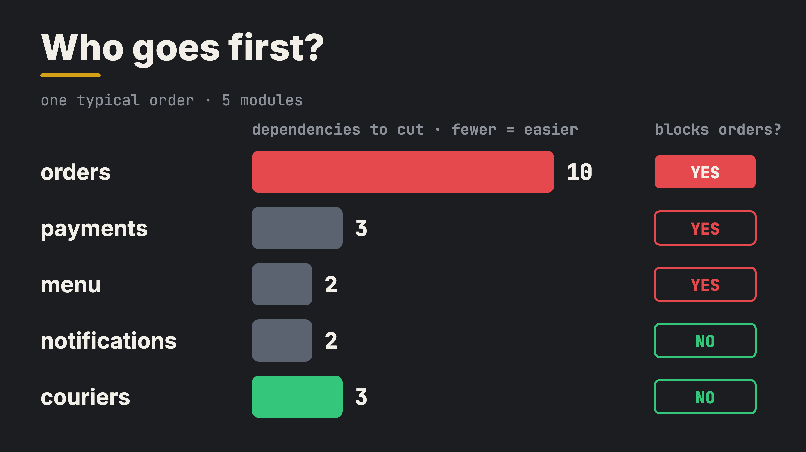
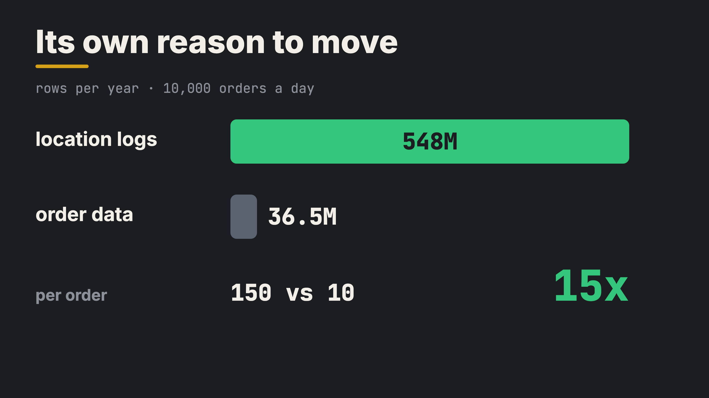
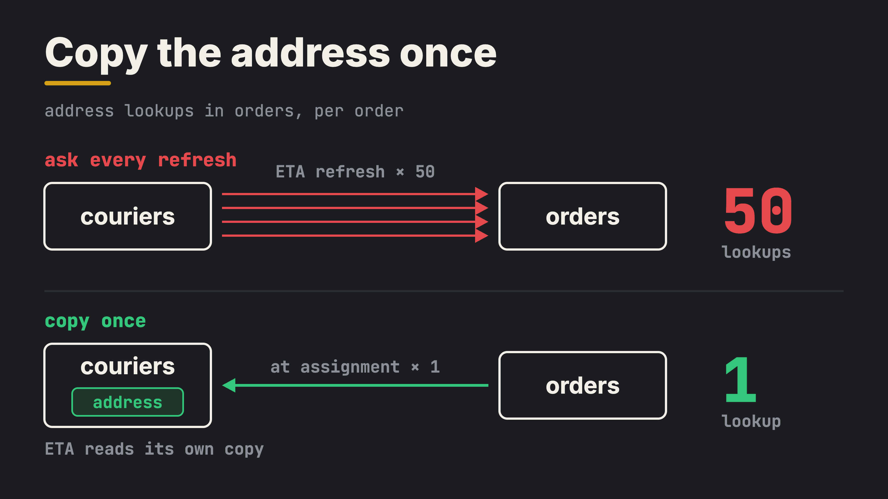
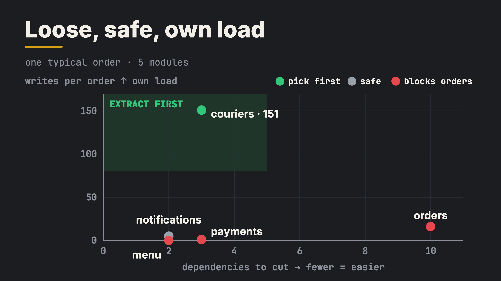

The most important service is usually the wrong one to extract first.

You've decided to split the monolith. Maybe teams block each other's releases. Maybe one part needs far more resources than the rest. Maybe every release risks the whole platform. (If you don't have reasons like these, a modular monolith is often the better answer. This piece is for teams that already have them.)

Now the first question: which part goes first? The instinct says orders. It's the core, it hurts the most, and it's where the money is. I tested that instinct.

## The test

I rebuilt a small version of the kind of food-delivery monolith I worked on from day one, a few years ago: menu, orders, payments, couriers and notifications, all in one shared database. Same shortcuts most monoliths grow: orders reads the menu's tables directly, payments writes the orders tables. Notifications are sent as events, so a failed message never fails an order. I ran one typical order through it, from 3 items to DELIVERED, and recorded every SQL statement and every call between modules. The numbers come from this model, not from a real system.

A **dependency** is any place where one module touches another: a table it reads or writes, a function it calls. After extraction, each dependency becomes an API call or a data contract.

- **orders:** 10 dependencies, 10 calls and events per order, 16 writes per order, blocks orders
- **payments:** 3 dependencies, 1 call, 1 write, blocks orders
- **menu:** 2 dependencies, no calls but 5 direct table reads, 0 writes, blocks orders
- **notifications:** 2 dependencies, 5 events, 5 writes, doesn't block orders
- **couriers:** 3 dependencies, 4 calls, 151 writes, doesn't block orders

Orders has 10 dependencies, all on the path that takes the money. Pull it out first, and you cut all of them at once. In my experience, that's where migrations stall.

## Start at the edge, but which edge?

The usual advice is to start small, at the edge. Menu has only 2 dependencies, but prices are read while every order is created. Payments too.

Notifications doesn't block orders: it's sent as an event, so a failed message can't fail an order. Honestly, it's a good candidate too.

So a third question decides: does it have its own reason to move? Notifications writes 5 rows per order. Couriers writes 151.

## Couriers: its own reason to move

Couriers has 3 dependencies, touches no other module's tables and doesn't block orders. And 150 of the order's 173 writes are its GPS points.

At 10,000 orders a day, that's 548M location logs a year, about 55 GB, 15x more than the order data. The write rate is easy for one Postgres: 62 a second at peak. The size is the problem. It slows down backups and vacuum, and competes with every other table for disk and cache.

Try the cheap step first: keep only the last 30 days, or split the table by day and drop old days. That can keep it in one Postgres for a long time.

Assumptions: a GPS point every 10 seconds, 25 minutes per delivery, 15% of the day's orders in the peak hour, about 100 bytes per row, kept for a year.

"You built the model, so you rigged it." Fair. So I changed one thing: how couriers gets the delivery address. The pick didn't change. Only the traffic did:

Copy the address once, when the courier is assigned, and the ETA reads its own copy: 1 address lookup per order. Ask orders on every refresh instead, and it's 50.

Still, count the dependencies in your own monolith. Yours isn't mine.

## What happened in real life

A food-delivery platform had the same question, and the courier part was picked first.

- It didn't block orders. When it was down, orders were still taken and paid, and couriers were dispatched by hand. The fleet was small then, so it worked.
- The order data it needed was copied in when a courier was assigned.
- Its core tables had few writes, so a bulk copy and a switch in quiet hours were enough. No dual writes.
- Location logs got their own database from day one: a spike there shouldn't hurt anything else, and append-only location data fits a different store better.
- Status updates, picked up and delivered, went back to the monolith through its API.

It went smoother than expected. Notifications went soon after. It had its own pain, provider limits and retries, but the location logs were growing faster. Orders stayed in the monolith longer, but with less tangled around it each time.

## Years later, I checked it against the books

For this article, I checked those decisions against the books. Most of them were already written down as best practices:

- **Start with a decoupled capability at the edge**, not the core (Zhamak Dehghani).
- **Move the data with the code.** A service that still shares the monolith's database is a distributed monolith: you pay for both (Dehghani, Sam Newman).
- **Bulk copy first.** Newman's data-move steps start with one too; the dual-write steps were skipped because writes were few.
- **Copy, connect, switch, step by step:** the strangler fig pattern (Martin Fowler).
- **Supporting parts before the core.** DDD's split into supporting and core subdomains draws the same map.

Some were missed:

- **Status updates pointed back.** Dehghani's rule is that dependencies point from the monolith to the new service, not back. Events would reverse it.
- **No retention first.** Keeping only recent location logs, or splitting the table by day, could have delayed the separate database.
- **The fallback only worked for a small fleet.** Manual dispatch doesn't scale, and no automatic fallback was planned.
- **No plan for stale copies.** An address changed after assignment had to reach the courier service somehow.

The solution wasn't perfect, but it was one of the fastest and easiest to achieve with the time and resources of that moment.

## Isn't the core the point?

Dehghani also says: decouple what is important to the business. I agree. The core is the goal. It's just not the first step.

Every supporting service you pull out takes its code, data and load out of the monolith and turns its dependencies into clear contracts. The first one also builds the road: the pipeline, the monitoring, the data move. Better to learn that on a part that can't stop the business.

## Decision

Ask three questions about every module:

- **Is it loosely coupled?** Count the dependencies and the calls behind them.
- **Can it block a critical flow without a fallback?** Taking orders, payments, delivery. If it runs inside one with nothing to fall back on, not yet.
- **Does it have its own reason to move?** Its own load, data growth or release pace.

Couriers answered all three: its critical flow, dispatch, had a manual fallback. Notifications, sent as an event, answers two, so it's a fine second. Orders goes later.

## Trade-off

You get a first extraction that can't block orders, an easy data move and room for the hot data to grow. It costs time: orders, the real pain, stays in the monolith longer. You run one more database, calls into the monolith become network calls, and copied data can go stale. An address changed after assignment has to reach the courier service. And a manual fallback only works while the fleet is small.

## Principle

Extract the supporting services first to free the core, not the core first.

Which part did your team pull out of the monolith first, and would you pick it again? Tell me in the comments.

Code and full results: https://github.com/archemist-dev/labs/tree/main/02-extract-first

Credit: Sam Newman, *Monolith to Microservices*; Zhamak Dehghani, "How to break a Monolith into Microservices"; Martin Fowler, "StranglerFigApplication". The words, test and numbers are mine.
